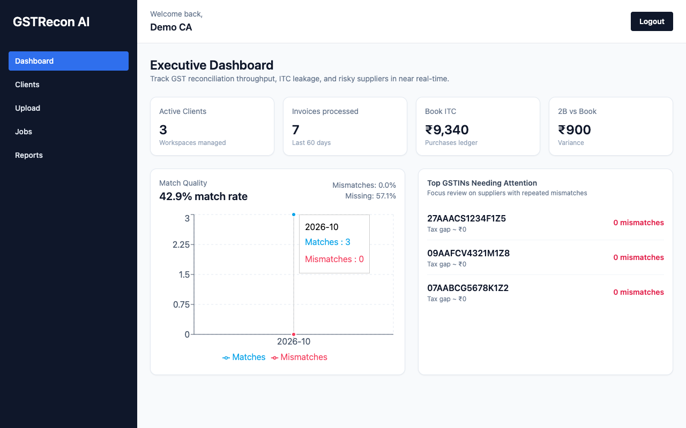

# GST Recon AI

**Live demo:** https://gst-recon-ai.vercel.app

[](https://render.com/deploy?repo=https://github.com/sangamyo/gst-recon-ai)

The backend deploys to Render from [`render.yaml`](render.yaml), and the frontend is on Vercel. On Render's free plan the API sleeps when idle, so the first request after a while can take about 50 seconds.




Reconcile an Indian GST **purchase register** against **GSTR-2B** in seconds. Upload two Excel files and get each invoice sorted as matched, tax mismatch, missing in 2B or extra in 2B, plus ITC totals and a formatted Excel report.

This repository has two parts:

| Part | Path | What it is |
| --- | --- | --- |
| **Web app** (main) | [`GSTReconAI/`](GSTReconAI) | Multi-user SaaS-style app: FastAPI backend + React dashboard. Clients, uploads, background reconciliation jobs, dashboards and report downloads. |
| **CLI** (lightweight) | [`GST_Recon_System/`](GST_Recon_System) | The original single-machine tool. Put `Purchase.xlsx` and `GSTR2B.xlsx` in one folder per client, run `python main.py`, get one report per client. No server or database. See its [README](GST_Recon_System/README.md). |

## How reconciliation works

1. **Validate**: check that the required columns are present.
2. **Normalize**: GSTINs are trimmed and uppercased; invoice numbers have spaces removed and are uppercased; dates in mixed formats (`01-04-2024`, `2024/04/01`, Excel dates) are parsed with DD-MM-YYYY as the default; tax amounts are coerced to numbers.
3. **Consolidate**: duplicate rows sharing the same `(GSTIN, invoice number, invoice date)` key are summed.
4. **Match**: one outer join on that key, then each row is classified:
   - `MATCH`: in both files and the tax difference is within ₹1
   - `TAX_MISMATCH`: in both files but the tax amounts differ
   - `MISSING_IN_2B`: in the purchase register only (ITC at risk)
   - `EXTRA_IN_2B`: in GSTR-2B only
5. **Report**: an Excel workbook with Summary, Matched, Tax_Mismatch, Missing_in_2B and Extra_in_2B sheets. Headers are frozen and mismatches are highlighted.

### Input format

| File | Required columns | Optional columns |
| --- | --- | --- |
| Purchase register | `Supplier_GSTIN`, `Invoice_No`, `Invoice_Date`, `Total_Tax` | `Taxable_Value`, `CGST`, `SGST`, `IGST` |
| GSTR-2B | `GSTIN_of_Supplier`, `Invoice_Number`, `Invoice_Date`, `Tax_Amount` | `Taxable_Value`, `Filing_Status` |

(The CLI also requires `CGST`, `SGST` and `IGST` in the purchase register.) Synthetic sample files live in [`GST_Recon_System/Clients/`](GST_Recon_System/Clients). They work with both the CLI and the web app.

## Tech stack

**Backend** (`GSTReconAI/backend`): Python 3.10+, FastAPI, SQLAlchemy 2, Pydantic v2 / pydantic-settings, pandas + openpyxl, JWT auth (PyJWT + passlib/bcrypt), PostgreSQL (SQLite for local dev), optional Celery + Redis.

**Frontend** (`GSTReconAI/frontend`): React 18, TypeScript, Vite, Tailwind CSS, React Router, Axios, Recharts.

**CLI** (`GST_Recon_System`): Python, pandas, openpyxl, colorama.

## Repository layout

```
.
├── GSTReconAI/
│   ├── backend/            # FastAPI app (Dockerfile, railway.toml, .env.example)
│   │   └── app/
│   │       ├── routes/     # auth, clients, uploads, reconciliation/dashboard
│   │       ├── services/   # recon_engine (pandas), report_generator (openpyxl)
│   │       └── utils/      # validation, normalization, logging
│   ├── frontend/           # React + Vite SPA (vercel.json, .env.example)
│   └── docker-compose.yml  # local full stack: api, worker, redis, postgres, frontend
└── GST_Recon_System/       # CLI version + synthetic sample data
```

## Running the web app locally

### Option A: no Docker (SQLite, no Redis)

```bash
# Backend
cd GSTReconAI/backend
python3 -m venv .venv && source .venv/bin/activate
pip install -r requirements.txt
cp .env.example .env            # defaults work as-is for local dev
uvicorn app.main:app --reload --port 8000
# API docs: http://localhost:8000/docs
```

```bash
# Frontend (new terminal)
cd GSTReconAI/frontend
cp .env.example .env            # VITE_API_URL=http://localhost:8000/api/v1
npm install
npm run dev                     # http://localhost:5173
```

With no `REDIS_URL`, uploads are reconciled inside the API process (FastAPI `BackgroundTasks`), so you need no worker. Tables are created automatically on startup.

### Option B: Docker Compose (Postgres + Redis + Celery worker)

```bash
cd GSTReconAI
docker compose up --build
# API http://localhost:8000/docs · Frontend http://localhost:5173
```

### Using the app

1. Register at `/register` and sign in.
2. Create a client: a name and a 15-character GSTIN.
3. Upload a purchase register and a GSTR-2B workbook for that client.
4. Watch the job on **Jobs**, then download the Excel report or open the **Dashboard**.

### Running the CLI

```bash
cd GST_Recon_System
python3 -m venv .venv && source .venv/bin/activate
pip install -r requirements.txt
python main.py                  # reports are written to GST_Recon_System/Output/
```

## Environment variables

### Backend (`GSTReconAI/backend`)

| Variable | Required | Default | Description |
| --- | --- | --- | --- |
| `ENV` | Production: yes | `development` | Set to `production` to turn on strict checks. |
| `GSTRECON_SECRET_KEY` | **Yes in production** | dev-only fallback | JWT signing key. With `ENV=production` the app refuses to start unless this is set and at least 32 characters. Generate one with `python -c "import secrets; print(secrets.token_urlsafe(48))"`. |
| `DATABASE_URL` | Production: yes | `sqlite:///./gstrecon.db` | SQLAlchemy URL. `postgres://…` and `postgresql://…` (the Railway/Heroku formats) are normalized to `postgresql+psycopg2://…`. |
| `REDIS_URL` | No | none | If set, jobs are queued to Celery and you need a worker. If unset, jobs run in-process. If the broker can't be reached, the API falls back to in-process execution. |
| `CELERY_BROKER_URL` / `CELERY_RESULT_BACKEND` | No | `REDIS_URL` / none | Override the broker, or turn on a result backend. |
| `CORS_ORIGINS` | Production: yes | `http://localhost:5173,http://127.0.0.1:5173` | Comma-separated list of allowed frontend origins, e.g. `https://gst-recon.vercel.app`. |
| `CORS_ORIGIN_REGEX` | No | none | Optional regex for extra origins, e.g. `https://gst-recon-.*\.vercel\.app` for preview deployments. |
| `STORAGE_DIR` | No | `./storage` (`/app/storage` in Docker) | Where uploaded workbooks, reports and logs are written. |
| `ALLOW_ADMIN_SIGNUP` | No | `false` | If `true`, self-registration may choose the `admin` role, which can see every tenant's data. Keep it `false` on public deployments. |
| `JWT_EXPIRATION_MINUTES` | No | `720` | Access-token lifetime. |
| `PORT` | No | `8000` | Port uvicorn listens on. Railway sets it automatically. |

### Frontend (`GSTReconAI/frontend`)

| Variable | Required | Description |
| --- | --- | --- |
| `VITE_API_URL` | Yes (prod) | Backend base URL **including** `/api/v1`, e.g. `https://your-api.up.railway.app/api/v1`. It is baked in at build time, so redeploy after you change it. |

## Deployment

### Backend on Railway

1. Create a new project and deploy from this GitHub repo.
2. Service settings → **Root Directory**: `GSTReconAI/backend`. Railway picks up the `Dockerfile` and `railway.toml`. The health check is `/health` and the server listens on `$PORT`.
3. Add a **PostgreSQL** database. In the backend service's variables, set `DATABASE_URL` to `${{Postgres.DATABASE_URL}}`.
4. Set these variables: `ENV=production`, `GSTRECON_SECRET_KEY=<random 48+ chars>`, `CORS_ORIGINS=https://<your-app>.vercel.app`.
5. *(Optional, recommended)* Attach a **Volume** mounted at `/app/storage` so uploads and reports survive redeploys. The container runs as a non-root user, so if the volume isn't writable, also set `RAILWAY_RUN_UID=0`.
6. *(Optional)* Add **Redis** and set `REDIS_URL=${{Redis.REDIS_URL}}`. Then add a second service from the same repo and root directory, with start command `celery -A app.celery_app.celery_app worker -Q reconciliation --loglevel=info`, the same variables, and access to the same storage. If you skip Redis, the API reconciles in-process, which is the cheapest setup and works fine for typical file sizes.

Database tables are created automatically when the app starts.

### Frontend on Vercel

1. Import the repo into Vercel.
2. **Root Directory**: `GSTReconAI/frontend`. Framework preset: **Vite**. Build command: `npm run build`. Output directory: `dist`.
3. Environment variable: `VITE_API_URL=https://<your-railway-domain>/api/v1`.
4. `vercel.json` already rewrites every route to `index.html`, so client-side routes like `/dashboard` work on refresh.
5. Add the Vercel URL to the backend's `CORS_ORIGINS`.

## API overview

All routes live under `/api/v1`. Interactive docs are at `/docs`.

| Method | Path | Description |
| --- | --- | --- |
| POST | `/auth/register` | Create an account |
| POST | `/auth/login` | OAuth2 password form → JWT |
| GET | `/auth/me` | Current user |
| GET/POST | `/clients` | List / create clients |
| GET | `/clients/{id}/jobs` | Jobs for a client |
| POST | `/clients/{id}/jobs` | Upload `purchase_file` + `gstr2b_file` (multipart) and start a job |
| GET | `/reconciliation/jobs/{id}` | Job status and counts |
| GET | `/reconciliation/jobs/{id}/report` | Download the Excel report |
| GET | `/reconciliation/dashboard/metrics` · `/monthly-trend` · `/top-risk` | Dashboard data |
| GET | `/health` | Liveness check (outside `/api/v1`) |

## Notes and limitations

- Uploaded files are stored on local disk (`STORAGE_DIR`). On Railway, attach a volume, or files will be lost on redeploy. With a separate Celery worker, the API and the worker must share that storage.
- Schema changes are applied with `create_all` on startup; there are no Alembic migrations yet.
- The sample workbooks under `GST_Recon_System/Clients/` contain synthetic data only.

## License

[MIT](LICENSE) © Hari Om Kasaundhan
